<!-- readme-atelier:start -->
<!-- Generated by Readme Atelier (https://github.com/monokernn/readme-atelier). Edit atelier.yml instead of this block. -->

<picture><source media="(prefers-color-scheme: dark)" srcset="./atelier/header-dark.02038b21.svg"/></picture>

  <a href="https://github.com/fefeliperoar"><picture><source media="(prefers-color-scheme: dark)" srcset="./atelier/social-github-dark.b78b0175.svg"/></picture></a>&nbsp;
  <a href="https://asociativo.com"><picture><source media="(prefers-color-scheme: dark)" srcset="./atelier/social-website-dark.05b4c040.svg"/></picture></a>&nbsp;
  <a href="https://www.linkedin.com/in/feliperoaramirez"><picture><source media="(prefers-color-scheme: dark)" srcset="./atelier/social-linkedin-dark.0d01b298.svg"/></picture></a>&nbsp;
  <a href="mailto:felipeandresroa.r@gmail.com"><picture><source media="(prefers-color-scheme: dark)" srcset="./atelier/social-email-dark.0155d813.svg"/></picture></a>

  <a href="https://github.com/fefeliperoar/oir-la-luz"><picture><source media="(prefers-color-scheme: dark)" srcset="./atelier/repo-1-dark.cbf2c2f9.svg"/></picture></a>
  <a href="https://github.com/fefeliperoar/dos-realidades"><picture><source media="(prefers-color-scheme: dark)" srcset="./atelier/repo-2-dark.d5794fe4.svg"/></picture></a>
  <a href="https://github.com/fefeliperoar/tacto"><picture><source media="(prefers-color-scheme: dark)" srcset="./atelier/repo-3-dark.3cd0e563.svg"/></picture></a>

<picture><source media="(prefers-color-scheme: dark)" srcset="./atelier/activity-dark.291df249.svg"/></picture>

<picture><source media="(prefers-color-scheme: dark)" srcset="./atelier/stack-dark.a55541b4.svg"/></picture>

<picture><source media="(prefers-color-scheme: dark)" srcset="./atelier/footer-dark.26c4b49e.svg"/></picture>

<!-- readme-atelier:end -->  
Practice

Industrial Designer with a strong interest in designing and developing new technologies. Experienced in interdisciplinary projects involving Design, Engineering, and Art. Developed products and solutions for environmental, health, museum, education, and mining industries. Director of Asociativo, a design studio in Santiago.

 
Teaching

Universidad Diego Portales · Design, Digital Interaction track

Digital Interaction Studio
Elective: Peripheral Devices and Platforms for Digital Interaction

Universidad del Desarrollo · Design and Engineering

Technological Device Development Studio
 
Selected work

Oír la luz · Hearing light. A sound exploration exercise.  oir-la-luz

Dos realidades · Two realities. A base web piece each student builds into their own version.  dos-realidades

Tacto · Touch. Turns a phone into a touch remote for audiovisual web experiences, streaming position, fingers, pressure and device rotation over MQTT to a mapping panel.  tacto

WLED Lighting · A programmable LED lighting system for spaces and objects.  wled-udd

Course materials and documentation are in Spanish.

 
Research

Areas of interest: affective computing · physical computing · interactive technologies · applied artificial intelligence · digital fabrication · creative coding · vibe coding for design.

 

Felipe Andrés Roa Ramírez · Santiago, Chile · LinkedIn · Instagram · Asociativo
