<!-- readme-atelier:start -->
<!-- Generated by Readme Atelier (https://github.com/monokernn/readme-atelier). Edit atelier.yml instead of this block. -->

<picture><source media="(prefers-color-scheme: dark)" srcset="./atelier/header-dark.e4b5d771.svg"/></picture>

  <a href="https://github.com/fefeliperoar"><picture><source media="(prefers-color-scheme: dark)" srcset="./atelier/social-github-dark.b78b0175.svg"/></picture></a>&nbsp;
  <a href="https://asociativo.com"><picture><source media="(prefers-color-scheme: dark)" srcset="./atelier/social-website-dark.05b4c040.svg"/></picture></a>&nbsp;
  <a href="https://www.linkedin.com/in/feliperoaramirez"><picture><source media="(prefers-color-scheme: dark)" srcset="./atelier/social-linkedin-dark.0d01b298.svg"/></picture></a>&nbsp;
  <a href="mailto:felipeandresroa.r@gmail.com"><picture><source media="(prefers-color-scheme: dark)" srcset="./atelier/social-email-dark.0155d813.svg"/></picture></a>

  <a href="https://github.com/fefeliperoar/oir-la-luz"><picture><source media="(prefers-color-scheme: dark)" srcset="./atelier/repo-1-dark.cbf2c2f9.svg"/></picture></a>
  <a href="https://github.com/fefeliperoar/dos-realidades"><picture><source media="(prefers-color-scheme: dark)" srcset="./atelier/repo-2-dark.d5794fe4.svg"/></picture></a>
  <a href="https://github.com/fefeliperoar/MCD-CA-ROA"><picture><source media="(prefers-color-scheme: dark)" srcset="./atelier/repo-3-dark.957ff1d3.svg"/></picture></a>
  <a href="https://github.com/fefeliperoar/collabprog-udd"><picture><source media="(prefers-color-scheme: dark)" srcset="./atelier/repo-4-dark.58d16faa.svg"/></picture></a>

<picture><source media="(prefers-color-scheme: dark)" srcset="./atelier/activity-dark.0a0a04b0.svg"/></picture>

<picture><source media="(prefers-color-scheme: dark)" srcset="./atelier/stack-dark.a55541b4.svg"/></picture>

<picture><source media="(prefers-color-scheme: dark)" srcset="./atelier/footer-dark.4513428e.svg"/></picture>

<!-- readme-atelier:end -->
